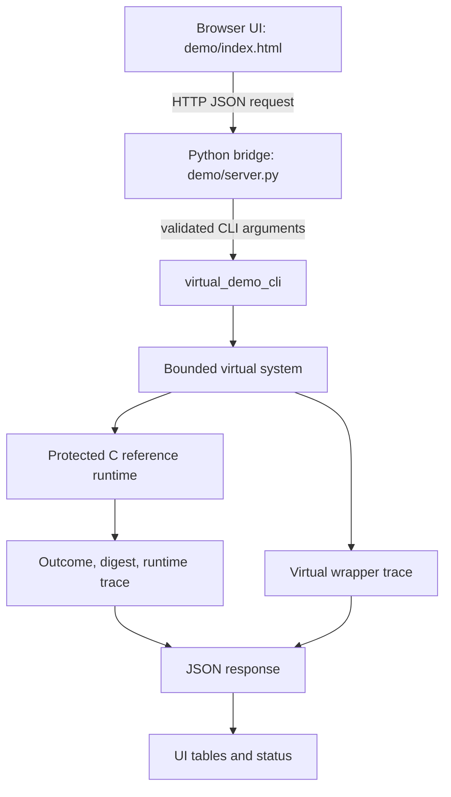

# Architecture and Repository Map

## 1. Runtime flow

**Authority rule:** `reference/src/ref_runtime.c` is the recovery decision/state-transition authority. The virtual adapter models the environment. Python validates requests and launches the CLI. JavaScript renders returned data. No UI-side recovery policy should be added.

## 2. Repository map

| Path | Purpose | Authority / status |
|---|---|---|
| `README.md` | Public entry point and status | Reader-facing summary |
| `docs/PROJECT_OVERVIEW.md` | Research question, claims, limits, future work | Curated project narrative |
| `docs/DEMONSTRATOR_GUIDE.md` | Build, launch and acceptance procedure | User-facing runbook |
| `docs/ARCHITECTURE_AND_REPOSITORY_MAP.md` | Component responsibilities and file map | Curated architecture |
| `demo/index.html` | Professor-facing browser UI | Presentation/control only |
| `demo/server.py` | Request validation and C CLI bridge | Transport/orchestration only |
| `demo/scenarios_data.json` | Read-only fallback/evidence data where configured | Not live execution authority |
| `demo/test_ui_contracts.py` | UI/bridge/CLI contract tests | Automated contract checks |
| `reference/src/ref_runtime.c` | Recovery state machine and trace authority | Protected, frozen |
| `reference/include/ref_runtime.h` | Runtime interface/contracts | Protected, frozen |
| `reference/virtual/src/virtual_system.c` | Bounded virtual peripheral state and admission | Environment model |
| `reference/virtual/src/virtual_scenarios.c` | Registered deterministic scenarios | Scenario source |
| `reference/virtual/src/virtual_demo_cli.c` | CLI/JSON adapter | Execution interface |
| `reference/tests/test_reference.c` | Runtime unit/invariant tests | Runtime verification |
| `reference/virtual/tests/` | Virtual-system and baseline tests | Adapter verification |
| `reference/experiments/` | Host/K.10 experiment sources and inputs | Frozen experiment tooling; do not rerun to rewrite evidence |
| `research/phase1_gate*_final.md` | Gates A–E | Normative design/protocol |
| `research/phase2_k10_p4_advantage_novelty_results.md` | Frozen K.10 results | Historical evidence; do not edit casually |
| `research/phase2_k10_4_*.md` | Final technical distinction/conclusion | Research interpretation |
| `research/phase2_k11_*.md` | Software synthesis/hardware handoff | Final synthesis |
| `research/phase2_k12_*.md` | Software demo and audit | Productization/audit |
| `research/chat_records/` | Checkpoint-level records | Historical provenance |
| `PROJECT_STATE.md`, `CURRENT_HANDOFF.md`, `DECISION_LOG.md` | Detailed continuity/governance | Operational/historical; not the public narrative |

## 3. Source-of-truth hierarchy

1. Protected runtime and frozen Gate A–E contracts for implementation behavior.
2. Frozen K.10 results for the recorded experiment outputs.
3. K.10.4 conclusion for evidence-bounded interpretation.
4. K.11 synthesis and K.12 audit for software demonstration and limitations.
5. `PROJECT_STATE.md` and `CURRENT_HANDOFF.md` for current project/maintenance status.
6. `README.md` and `docs/` for public presentation/navigation.
7. Dated checkpoint records for history, not current status.

A summary never silently overrides a frozen record. When a discrepancy cannot be resolved from primary evidence, describe the uncontested result and omit the disputed numeric claim.

## 4. Protected boundaries

Do not change without a new explicitly scoped research decision:
- `reference/src/ref_runtime.c`
- `reference/include/ref_runtime.h`
- `research/phase1_reference_implementation_design.md`
- `research/phase2_k9_methodology_lock.md`
- `research/phase2_k9_2_p4_advantage_novelty_design.md`
- frozen K.10 results and Gate-defining contracts.

## 5. History policy

The original K.1–K.12 records remain in `research/chat_records/`; old checkpoint documents are not deleted just to make the public entry point shorter. The curated `docs/` directory is the preferred reader path. Root continuity files remain for operational traceability.
