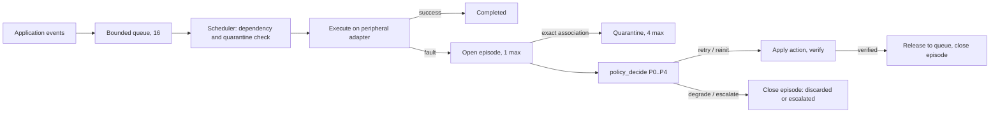
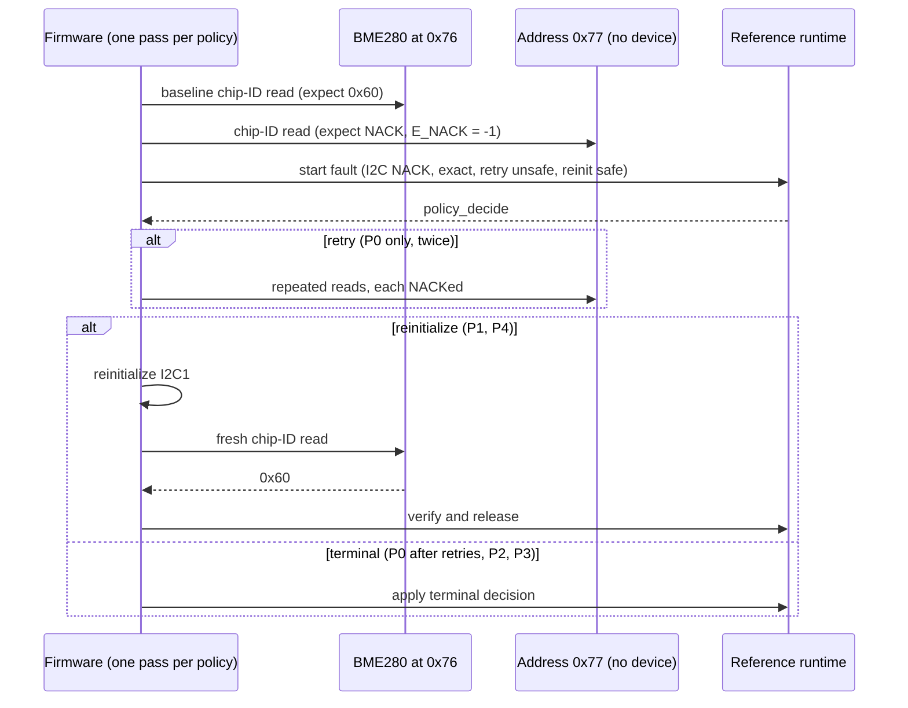

<!-- Draft v0.1, 2026-10-26. Ledger tags <!--Lnn--> map each empirical paragraph to EVIDENCE_LEDGER.md. Remove all comments before submission. -->
<!-- Target-venue constraints applied provisionally (Journal of Systems Architecture, Elsevier): abstract <= 200 words, <= 5 keywords, numbered sections, highlights. Re-check the CURRENT guide for authors before submission (see OPEN_ISSUES O-20). Reference style is numeric here; convert to the venue style. -->

# Bounded, Zero-Heap, Context-Aware Peripheral Recovery with Event Quarantine for Event-Driven Embedded Systems: A Host Evaluation and a Controlled I²C Hardware Demonstration

> **Title status: PROPOSAL.** No approved or frozen title or abstract was found in the repository. The only recorded name is the working title "Zero-Heap Context-Aware Peripheral Recovery with Event Quarantine" (`DECISION_LOG.md`, line 87). The title and abstract below are proposals for author approval.

**Authors:** SUJIT SAI Y [affiliation: PLACEHOLDER], MITHUL RASHWANTH SR [affiliation: PLACEHOLDER], ROHIT MATHUR* [affiliation: PLACEHOLDER]
*Corresponding author: ROHIT MATHUR, [email: PLACEHOLDER]. Author names and order come from the task brief; the repository contains no author record to check them against.

## Abstract

Peripheral faults in event-driven microcontroller firmware are usually handled by fixed retry loops, or by recovery machinery that assumes checkpointing, logging or operating-system support. We study a lightweight alternative: a zero-heap, statically bounded recovery policy (P4) that chooses an action from the evidence available about a fault, a short attempt history and safety flags, and quarantines only the associated event. Five policy variants (P0–P4) are implemented in one C reference runtime and compared in a deterministic host campaign of 16 case families × 5 policies × 5 repetitions (400 executions). P4 closes the recovery episode in all 16 reported families; each baseline leaves it active in at least two. The baselines are our own constructions and share P4's quarantine mechanism, and one family shows a cheaper baseline (1 versus 3 attempts). A controlled I²C address-NACK demonstration on an STM32 NUCLEO-L476RG with a BME280 produced successful policy-selected reinitialization and fresh chip-ID readback (0x60) for P1 and P4, while P0, P2 and P3 ended in terminal escalation. Five additional no-full-initialization control trials observed the absent-address NACK and then successfully read chip ID 0x60. These observations are limited to the tested address-NACK setup; no stuck-bus recovery, independent repeated policy runs, measured runtime stack or latency, or general superiority of P4 is claimed.

**Keywords:** peripheral fault recovery; embedded runtime; event quarantine; bounded resources; fault injection

**Highlights**
- A five-variant recovery-policy comparison in one zero-heap C runtime.
- 400 deterministic host executions across 16 case families, reported per family.
- P4 closes every reported recovery episode; trade-offs and shared mechanisms are stated.
- One controlled I²C NACK run on STM32L476RG with a BME280 sensor, kept separate from the host results.

---

## 1. Introduction

Microcontroller firmware talks to sensors, flash and radios through buses such as I²C and SPI. These peripherals fail in ways the application cannot prevent: a device NACKs, a transfer times out, arbitration is lost, a bus error is flagged. The common response is a retry loop with a fixed bound. It is simple and predictable, but it treats every fault alike. It does not ask whether a retry is safe for the pending transaction, whether the fault can be tied to one event, or whether other queued work depends on the failed one.

Research on peripheral and driver recovery offers stronger mechanisms. Phoenix tracks program and external peripheral state and rolls back to the failed access [1]. KARMA addresses peripheral consistency for asynchronous operations under intermittent power [2]. Shadow drivers and microreboots recover whole drivers or components in larger operating systems and services [3,4]. These mechanisms carry costs that small event-driven firmware may not accept: checkpoint memory, replay logs, or an operating-system layer.

This paper asks a narrower question. *How far can a small, statically sized runtime go in recovering from peripheral faults by using only the evidence at hand: the fault class, how precisely the fault can be tied to an event, a short attempt count, and a few safety flags?* We call the resulting policy P4 and compare it with four simpler variants, P0–P3, built into the same runtime.

**Contributions.** Within the evidence boundaries of Section 10, the paper contributes:

1. A recovery runtime with a fixed-size event pool, bounded quarantine and a single recovery episode, written in C without dynamic allocation (Sections 3–4).
2. Five policy variants (P0–P4) that differ only in the decision function, so that comparisons isolate policy logic (Section 4.1).
3. A frozen, deterministic host/reference campaign of 400 executions with per-family outcomes, including cases where P4 does not help and where a baseline is cheaper (Sections 5–6).
4. A separate, bounded hardware demonstration: one P0–P4 policy comparison run and five no-full-initialization control trials for a controlled I²C address NACK on an STM32L476RG (Section 7).
5. An explicit audit of what the evidence does not show, including source-level findings that qualify the boundedness claim (Sections 4.4 and 10).

We make no claim that P4 is novel as a whole, state of the art, or superior in general. Section 2.3 explains the narrow comparison on which the contribution rests.

## 2. Background and related work

### 2.1 Peripheral, driver and component recovery

Phoenix is the closest published system to our setting. It targets resource-constrained embedded systems, logs peripheral accesses, tracks program and external peripheral state, and rolls back to the failed access, using as little as 6 KB of memory in the authors' report [1]. Recovery therefore depends on checkpointing and replay. KARMA addresses a different fault source: intermittent power makes peripheral operations inconsistent, and the system provides a general abstraction for synchronous and asynchronous operations in that setting [2]. Shadow drivers monitor a device driver and take over its role during recovery so that applications and the kernel continue to run [3]. Microreboots restart fine-grained components to give cheap recovery [4]. Peripheral-state restoration middleware such as RESTOP records external peripheral operations so configuration can be restored after an interruption [11], while experimental I²C-bus analysis catalogs bus failure modes and mitigation options [12]. These are related but distinct problems: RESTOP targets power-interruption state retention, and the I²C study focuses on bus-level fault mitigation rather than the event-to-fault association policy evaluated here. The driver and component-recovery works [3,4] target commodity operating systems and server software, not event-driven firmware without an operating system.

We treat these four works as *conceptual comparators*, not as sources of our baselines. Our P0–P3 were designed by us as ablations of P4 (Section 4.1). The repository records no verified claim that any of them reproduces a published algorithm, and we do not make one. <!--L01-->

### 2.2 Dependability terminology and runtime monitoring

We use the fault, error and failure terminology and the classification of the means of dependability, including fault tolerance, from the dependability taxonomy [5]. Runtime verification offers a complementary view: it observes a running system against formal properties. Reinbacher et al. present resource-bounded runtime monitoring for embedded real-time systems [6]. Kempa et al. embed online runtime verification for fault disambiguation on a robotic platform [7]. Heffernan et al. monitor selected safety properties of an automotive embedded system, guided by ISO 26262 [9]. These works detect and classify; our runtime decides and acts. We borrow the idea that a fault verdict can be uncertain, which motivates the association levels in Section 3.

Surveys organize embedded fault-tolerance methods across software and hardware mitigation [13], as well as power, energy and thermal constraints [8]. A broader review covers data-error detection and recovery techniques in embedded systems [15]. Software fault-tolerance research also discusses recovery through changes to the execution environment, including retry, reboot and failover [14], while real-time embedded work has examined fault tolerance alongside energy and scheduling constraints [16]. OS-level task redundancy has separately been evaluated for transient faults [10]. These sources frame the problem but do not describe the same event-level peripheral-recovery policy, and we cite them for context rather than as implementations of our baselines.

### 2.3 Research gap and scope of the claim

Among the sources reviewed here, peripheral recovery for embedded targets relies on checkpointing and replay [1,2], and driver or component recovery is developed for operating-system or server settings [3,4]. We did not find in this set a recovery policy that (i) runs in a statically sized event runtime without dynamic allocation, (ii) limits its action to the precision of the fault-to-event association, and (iii) quarantines only the associated event while other work proceeds. **This statement is limited to the sources reviewed**; a systematic literature search was not performed for this draft, and project notes identify further prior-art strands (patents, message-queue systems, and robustness work on peripheral failures in embedded software) that must be reviewed before any gap statement is submitted (OPEN_ISSUES O-14, O-15). Individual mechanisms in P4, such as bounded retry, reinitialization, degradation and quarantine, are standard ideas. The claim of this paper concerns their integration in one bounded runtime and its evaluation, not any single mechanism. <!--L02-->

## 3. System model and assumptions

**Platform model.** The runtime targets single-threaded, event-driven firmware without an operating system. Events are produced by application code and executed one at a time by a scheduler. A peripheral operation is an event of type read, write, service, housekeeping or recovery control (`EventType`). Events carry a criticality (critical, normal, deferable), a dependency list and a transaction identifier.

**Static capacity.** The runtime holds at most `QMAX = 16` queued events, `XMAX = 4` quarantined events, `ACTIVE_MAX = QMAX + XMAX = 20` event slots, `DMAX = 4` dependencies per event, one recovery episode (`EPMAX = 1`) and a trace buffer of `TRACE_EVENT_CAP = 256` records. All state lives in one `Runtime` structure. <!--L03-->

**Fault model.** Faults are injected by software into the host model; they are classes (I²C NACK, timeout, bus error, arbitration loss, persistent I²C fault, SPI timeout, SPI verification failure, SPI persistent fault, software service fault, ambiguous fault). A fault is *associated* with an event at one of four levels: exact event, service only, peripheral only, or unknown (`AssociationLevel`). Association is an input to the policy. The runtime does not infer it.

**Assumptions.** (A1) Safety flags (`retry_safe`, `reinit_safe`, `degrade_safe`), dependency safety and shared-state validity are supplied by the caller and are correct. (A2) One fault episode is active at a time. (A3) Recovery actions are abstract in the host model: a retry or reinitialization either succeeds or fails according to the injected schedule. (A4) The hardware experiment injects only an address NACK, not a stuck bus (Section 7).

## 4. Policies and runtime

### 4.1 Policy variants

All five variants are implemented as branches of one function, `policy_decide()`, in `reference/src/ref_runtime.c`. They return one of five actions: none, retry, reinitialize or reset, degrade, escalate. Table 1 summarizes the rules as read from the source. <!--L04-->

**Table 1.** Decision rules of the five variants (source: `policy_decide`). *Attempt* is the number of recovery actions already taken in the episode.

| Variant | Rule, in priority order |
|---|---|
| P0 fixed retry | Retry while attempt < 2; otherwise escalate. Ignores all context. |
| P1 fixed retry + recovery | Retry if attempt < 2 and retry-safe; else reinitialize if reinit-safe and attempt < 3; else degrade if degrade-safe; else escalate. |
| P2 context only | Degrade or escalate if association is unknown, dependencies are unsafe or shared state is invalid. Else reinitialize if the fault is persistent and reinit-safe; else retry if retry-safe; else degrade or escalate. No attempt limit. |
| P3 context + history | As P2, but reinitialize once attempt ≥ 2 if reinit-safe; retry only while attempt < 2. No upper attempt limit. |
| P4 integrated | Escalate unless association is exact; degrade or escalate if dependencies are unsafe or shared state is invalid; terminate (degrade or escalate) at attempt ≥ 3; at attempt 2 reinitialize if reinit-safe, else degrade or escalate; otherwise retry if retry-safe, else reinitialize if reinit-safe, else degrade, else escalate. |

Two source-level observations qualify this table. First, in P4 the branch that escalates when association is unknown and the event is not degradable (reason code 18) cannot be reached, because unknown association is already handled by the first branch. Second, the decision's target scope is initialized from the association evidence, so the invariant "scope never exceeds evidence" holds by construction and the clamp at the end of `policy_decide()` never changes the result. <!--L05-->

### 4.2 Runtime architecture

Figure 1 shows the structure. Events enter a bounded queue (`runtime_admit`). The scheduler (`scheduler_select`) picks the first queued event whose dependencies allow dispatch and which is not fault-associated. When an execution fails, `runtime_start_fault` opens the single recovery episode; if association is exact, the failed event moves to quarantine and leaves the queue. Other events continue. `policy_decide` selects an action, `runtime_apply_policy` carries it out, and `runtime_verify_and_release` returns a verified event to the queue and closes the episode. Terminal degrade or escalate closes the episode and marks the event discarded or escalated.

*Figure 1. Runtime flow (drawn from `ref_runtime.c`). To be redrawn as a vector figure for submission.*

### 4.3 Episode and quarantine semantics

A quarantined event is not dispatched. It keeps its slot and generation, so a stale reference to a recycled slot is rejected (`OUTCOME_STALE_REF`). Quarantine of the exact event is applied by `runtime_start_fault` for every variant. It is therefore a shared mechanism and not a P4-only feature, and the host campaign confirms identical work preservation across P0–P4 in the queue-pressure and load families (CF02, CF14). <!--L06-->

### 4.4 Boundedness and zero-heap

**Zero heap.** A text search of `ref_runtime.c` and `ref_runtime.h` found no call to `malloc`, `calloc`, `realloc` or `free`. All storage is in `Runtime`. On the x86-64 host build used for this audit, `sizeof(Runtime)` is 8164 bytes, `sizeof(EventSlot)` is 84 bytes and the trace buffer is 6144 bytes. These are host figures. They are not MCU Flash or RAM measurements. <!--L07-->

**Bounded decision time.** `policy_decide` contains no loop or recursion. Other runtime functions loop over at most `ACTIVE_MAX` slots or `QMAX` queue entries. These are source-level bounds on operation counts. No execution time was measured. <!--L08-->

**Bounded recovery ladder.** P0, P1 and P4 stop issuing actions after a fixed number of attempts (2, 3 and 3 respectively, by Table 1). P2 and P3 contain no attempt limit; with persistent faults and safety flags that stay true, they keep selecting actions until the caller stops. This is the source-level reason for the "no terminal" outcomes of P2 and P3 in CF05 and CF06 (Section 6). <!--L09-->

**Two findings that qualify the bounds.** Both were reproduced in a scratch build outside the repository; the protected runtime was not changed.

1. *Release into a full queue.* A quarantined event leaves the queue, so other events can fill all 16 positions. If the quarantined event is then released, `queue_append` has no room. In a build with assertions the program aborts; in a build with `NDEBUG` the write goes one element past the queue array (reported by UBSan as index 16 of `uint8_t[16]`). The state is reachable with 16 admitted events, one exact-association fault and one further admission. The campaign cases keep the queue below this level.
2. *Generation exhaustion.* Each slot's generation counter is 8 bits and a value of 0 is reserved. After 255 admissions through the lowest free slot, `runtime_admit` returns `OUTCOME_STALE_REF` while the queue is empty and other slots are free. A runtime instance therefore has a finite admission lifetime of 255 events in this usage pattern. <!--L10-->

Neither finding appears in the frozen reports. They are limits of the reference implementation and are discussed in Section 10.

## 5. Experimental methodology

### 5.1 Frozen host/reference campaign

The campaign crosses 16 case families (CF01–CF16), five policy variants (P0–P4) and five repetitions, giving 400 deterministic executions. The families cover persistent faults with history, queue pressure, dependency order, association ambiguity, faults during recovery, recovery failure, subsequent faults after prior escalation, critical versus deferable work, repeated contention, follow-up work after reinitialization, alternating fault classes, queue position, low and high load, a negative control, and a baseline-lower-cost case. Inputs are declarative schedules (`reference/experiments/workloads.csv`, `fault_schedules.csv`). The report of record is `research/phase2_k10_p4_advantage_novelty_results.md`, produced by `reference/experiments/evaluate_k10_advantage.py`. The protected runtime files were reported unchanged by SHA-256 check in that report. The report does not list the hash values, so we recorded the current hashes (Appendix A) but cannot compare them with those of the K.10 run; the git history check is in EVIDENCE_LEDGER.md. <!--L11-->

### 5.2 Metrics and attribution

Each (family, policy) cell is reported as an outcome code and an attempt count. The outcome codes are success, terminal escalate, terminal degrade, stale reference, no terminal outcome within the harness bound, and episode full. A flag records whether the recovery episode was left active at the end. The frozen protocol attributes an observed difference to P4 only after considering shared mechanisms: where all variants behave identically, the result is credited to a shared mechanism. <!--L12-->

### 5.3 Environment

The frozen report was produced in the project's user-controlled Windows/MSVC environment; compiler version and host details are not recorded in the repository. Local test success (CMake/CTest and UI-contract tests) was reported by the user and has not been reproduced in continuous integration. <!--L13-->

## 6. Host results

Figure 2 and Table 2 summarize the 80 (family, policy) cells. The per-repetition raw files named in the report (`k10_runs.csv`, `k10_traces.csv`) are not in the repository, so we derived all numbers from the report's data columns. The report's free-text finding column was not used: it is fixed text in the generator script and conflicts with the data columns in two families (Section 10). <!--L14-->

*Figure 2. Outcome and attempt count for each case family and policy (frozen host/reference campaign). Hatched cells mark an episode left active. The CF01/P2 attempt count is disputed in the frozen record and omitted. Derived by `scripts/make_figures.py` from the report table.*

**Table 2.** Outcomes over the 16 case families, per policy (source: `derived/k10_policy_summary.csv`).

| Policy | Success | Terminal escalate | Terminal degrade | Stale ref | No terminal | Episode full | Episode left active |
|---|---:|---:|---:|---:|---:|---:|---:|
| P0 | 8 | 6 | 0 | 1 | 0 | 1 | 2 |
| P1 | 11 | 1 | 2 | 1 | 0 | 1 | 2 |
| P2 | 11 | 0 | 1 | 1 | 2 | 1 | 4 |
| P3 | 11 | 0 | 1 | 1 | 2 | 1 | 4 |
| P4 | 12 | 2 | 2 | 0 | 0 | 0 | 0 |

The success counts are not a ranking. In CF08 the report shows P0 completing the work (success, 1 attempt) while P1–P4 degrade deferable work (0 attempts), and the report's own text describes the opposite for P0. Whether degrading is the intended behavior in that family is not stated in the data. <!--L15-->

**Where P4 differs.** Two families separate P4 from all four baselines. In CF04 (non-exact association), P0–P3 return a stale-reference outcome and leave the episode active, whereas P4 escalates and closes it. In CF07 (a prior ambiguous fault followed by a second fault), the baselines' unclosed episode blocks the second fault (`episode full`), whereas P4 recovers in one attempt. In CF05 and CF06 (faults during recovery), P4 differs from P2 and P3 only: those two stop at four attempts with no terminal outcome and the episode active, whereas P4 stops at three; P0 and P1 also terminate, so P4 has no advantage over them in these families. Consistent with the source, the CF04 and CF07 difference arises because P0–P3 select a retry for a non-exact fault whose target is not a valid event reference; `runtime_apply_policy` then returns `OUTCOME_STALE_REF` without closing the episode. P4's rule for non-exact association avoids that path. <!--L16-->

**Where P4 does not help.** Seven of the 16 families give identical outcome, attempt count and episode state for all five policies: CF02, CF09, CF11, CF12, CF13, CF14 and CF15. The report text lists six and omits CF14; the table shows seven. Persistent-fault recovery (CF01, CF03, CF10) succeeds in P1–P4 through reinitialization, a mechanism P1 already has, and fails in P0, which cannot reinitialize. <!--L17-->

**Trade-off.** In CF16, where the fault is persistent and known to be so, P2 reinitializes at once and succeeds in one attempt, while P4 retries twice before reinitializing and needs three. This compares attempt counts in a software model. It is not a timing result, and the earlier wording that P2 is "three times faster" was corrected in the frozen record. <!--L18-->

**Reading the results.** The differences above come from rules we wrote into P4 and not into the baselines: the exact-association requirement, and a hard attempt limit. They show that these rules close two failure paths in the reference runtime. They do not show that P4 would outperform an independently designed policy, and the baselines share the exact-event quarantine, so the frozen record marks the ablation contract as not valid for P0–P3.

## 7. Physical hardware validation

This section reports one user-observed run. It is separate from Section 6: the microcontroller did not execute the 400-execution campaign.

### 7.1 Setup and method

The target is an ST NUCLEO-L476RG (board revision MB1136 C) with an STM32L476RG, connected to a BME280 at address 0x76 whose chip-ID register (0xD0) should read 0x60. A register-level I²C1 adapter (I²C timing value `0x30420F13`) is linked with the unchanged reference runtime. For each policy P0–P4 the firmware (i) conditions the bus and reads the chip ID as a baseline (up to three attempts, with a bus-clear routine of up to nine clock pulses while SDA is low, if SDA or SCL starts low); (ii) reads the chip ID at the wrong address 0x77 so that the device returns a NACK; (iii) opens a recovery episode in the runtime with a fixed context (I²C NACK, exact association, retry not safe, reinitialization safe) and asks the policy for a decision; (iv) executes retries at 0x77 while the policy asks for them; (v) if the policy selects reinitialization, reinitializes I²C1, re-reads the chip ID at 0x76 and releases the event through `runtime_verify_and_release`; otherwise applies the terminal decision. The firmware then evaluates `policy_decide` for 80 further contexts (5 policies × 16) without touching the bus. Source: `Plan2.0/firmware/bme280_policy_integration/embedded_runtime_five_policy_matrix_diagnostic.c`. Build, download and debugging used STM32CubeIDE and ST-LINK as reported by the user; tool versions were not captured. Figure 3 shows the per-policy transaction sequence. <!--L19-->

*Figure 3. Hardware transaction sequence per policy (drawn from `physical()` in the diagnostic firmware). To be redrawn as a vector figure.*

### 7.2 Observations

Values were read from debugger Expressions screenshots supplied by the user (Table 3). The screenshots are not committed to the repository.

**Table 3.** Observed values, one run (source: `Plan2.0/results/CHAT_11_FIVE_POLICY_DIAGNOSTIC_HARDWARE_RUN_2026-10-25.md`).

| Quantity | P0 | P1 | P2 | P3 | P4 |
|---|---:|---:|---:|---:|---:|
| Baseline error | 0 | 0 | 0 | 0 | 0 |
| Wrong-address read result (`E_NACK` = −1) | −1 | −1 | −1 | −1 | −1 |
| Physical status (7 = terminal, 1 = pass) | 7 | 1 | 7 | 7 | 1 |
| Runtime outcome code | 4 (terminal escalation) | 1 (success) | 4 (terminal escalation) | 4 (terminal escalation) | 1 (success) |
| Post-recovery read OK | 0 | 1 | 0 | 0 | 1 |
| Post-recovery chip ID | 0 | 0x60 | 0 | 0 | 0x60 |
| Release result (1 = success) | 0 | 1 | 0 | 0 | 1 |

The debugger reached the final breakpoint (`finished` = 1, `progress_stage` = 900). Sampled matrix statuses at indices 0, 15, 16, 31, 32, 47, 48, 63, 64 and 79 were all 1. Index 79 showed action 4, reason 19, terminal 1, retry authorization 0 and runtime start 1. The full 80-entry array was not exported, so the evidence is a sampled matrix check rather than a complete independently readable export. <!--L20-->

### 7.3 Interpretation

For P1 and P4, the observed sequence is: controlled NACK, I²C1 reinitialization, fresh chip-ID read of 0x60, successful release. P0, P2 and P3 ended with `OUTCOME_TERMINAL_ESCALATE` (numeric 4) and did not produce a successful post-fault read. This is a terminal policy outcome, not evidence of a processor crash.

Table 4 shows why the pass/terminal pattern arises. For the fixed hardware context, `policy_decide`, evaluated on the host, returns reinitialization for P1 and P4 and a terminal decision for P0 (after two retries), P2 and P3. The observed statuses 7, 1, 7, 7, 1 match. The physical outcomes therefore follow from the policy rules and the context flags we set (retry not safe, reinitialization safe). They do not show that the policies chose well for the physical fault. <!--L21-->

**Table 4.** Source-derived decision for the hardware context versus observed physical status (derived by `scripts/derive_source_decisions.py`; the decision column is a host computation, not a measurement).

| Policy | Source-derived first decision (reason) | Expected path | Observed status |
|---|---|---|---|
| P0 | retry (1), then escalate (2) after two failed retries | terminal | 7 (terminal) |
| P1 | reinitialize (4) | pass | 1 (pass) |
| P2 | escalate (11) | terminal | 7 (terminal) |
| P3 | escalate (16) | terminal | 7 (terminal) |
| P4 | reinitialize (23) | pass | 1 (pass) |

The three captured matrix entries also agree with the host computation: indices 0 and 1 (P0, contexts 0 and 1) give retry with reason 1, and index 79 (P4, context 15, shared state invalid) gives escalate with reason 19. <!--L22-->

Figure 4 shows the host-computed first decision of each policy over the 16 provisional contexts. P0 selects retry in 12 contexts and escalate in 4. P1 selects retry in 9, reinitialize in 5 and escalate in 2. P2 and P3 select retry in 8, reinitialize in 3, degrade in 2 and escalate in 3. P4 selects retry in 6, reinitialize in 4 and escalate in 6, and never degrades in these contexts. These counts describe the context set we chose. They are not performance results, and the contexts are not the frozen case families. <!--L22-->

*Figure 4. Source-derived first decision per policy over the 16 provisional firmware contexts (host computation by `scripts/derive_source_decisions.py`, not a hardware measurement).*

### 7.4 What this run does not show

The run does not show recovery from a physically stuck SDA or SCL line; the injected fault is an address NACK. It is not 80 physical fault injections, and the 16 firmware contexts are not established as identical to CF01–CF16. Five control trials showed successful sensor readback after the same absent-address NACK without a full `iinit()` call between the probe and subsequent read; this supports only a narrow conclusion for this fault scenario, because local transaction-abort/flag handling still occurs. The P0–P4 comparison was one policy run, not five independent policy repetitions, so no policy-level repeatability or variance is available. No runtime timing, stack, energy, or complete MCU resource profile was measured. The results do not establish general P4 superiority. <!--L23-->

## 8. Software demonstrator

A browser interface sends requests to a Python HTTP bridge (`demo/server.py`), which calls a C virtual-system adapter and scenario runner linked with the same reference runtime; the runtime remains the authority for recovery decisions, and the interface shows the outcome, a digest and correlated trace records. The demonstrator runs the software path only and is labeled as simulation. Its UI-contract tests (`demo/test_ui_contracts.py`) and the CMake/CTest suite were reported as passing by the user on 2026-10-13; we did not execute them for this draft. <!--L24-->

## 9. Discussion

**What the evidence supports.** In the host campaign, adding an exact-association requirement and a hard attempt limit to a context-aware policy removes two failure paths that the reference runtime exposes to the other variants: a leaked recovery episode after a non-terminal action on an invalid target, and unbounded action sequences under repeated recovery faults. The hardware run shows that the same decision code can drive a real I²C peripheral through a reinitialization path and a fresh read on a Cortex-M4 target.

**What it does not support.** The evidence does not support a claim that P4 is better than other published or independently designed policies, that quarantine is a P4 contribution, or that results transfer to other peripherals, fault types or MCUs. The cheaper behavior of P2 in CF16 and the identical behavior of all policies in seven families are part of the result. A simpler variant is sufficient whenever faults are transient, known to be persistent, or not ambiguous.

**Design implications.** The leaked-episode path shows that a recovery runtime should close or reject an episode whenever an action's target is invalid, independent of the policy. A runtime that did so would probably narrow the CF04 and CF07 differences. This is a hypothesis; it was not tested.

## 10. Threats to validity and limitations

*Internal.* The baselines were written by the authors from the same code base as P4. They are ablations and not reproductions of published algorithms. The frozen record marks P0–P3 as not satisfying the ablation contract because exact-event quarantine applies to all variants. Outcome codes are not commensurable across families, so we report them per family. The report's free-text column conflicts with the data columns for CF01 (P2 attempt count: table 3, text 1) and CF08 (P0 outcome: table success, text escalate); we use the data columns and omit the disputed CF01/P2 count. Raw per-repetition outputs are not in the repository, so repetition-level determinism is asserted by the report and not independently checked here.

*Construct.* Attempt counts are not time. Host decisions are not hardware behavior. The firmware contexts are provisional and their correspondence to CF01–CF16 is unknown.

*External.* One MCU, one sensor, one bus and one fault type (address NACK) were used. A static runtime of 16 queue entries and 20 slots was exercised; larger systems and other peripherals are untested.

*Hardware evidence.* The hardware values come from user-provided debugger screenshots; screenshots are not yet committed to the repository. No complete matrix export exists. Five no-full-initialization control trials are now recorded, but the modified control source is not separately committed or hash-linked to the flashed binary. The policy comparison is one run.

*Implementation limits.* The runtime has the two limits in Section 4.4 (full-queue release and 255-admission lifetime) and an episode-leak path for invalid targets. The trace buffer silently stops recording after 256 records. The bounds in Section 4.4 are source-level and unmeasured.

## 11. Future work

(1) Preserve the five-trial no-full-initialization control evidence and link the exact flashed binary to source if its original build artifact becomes available. (2) If future work permits, inject a physically stuck SDA or SCL line using a documented, safe method. (3) Measure Flash, RAM, stack and decision time on the MCU with raw outputs. (4) Reconcile the 16 firmware contexts with CF01–CF16, or define the matrix as a separate experiment. (5) Add independently designed baselines from the literature. (6) Fix and test the queue and generation limits through a separately approved research change. (7) Complete the systematic prior-art review.

## 12. Conclusion

A zero-heap recovery runtime with five policy variants was evaluated in a deterministic host campaign of 400 executions and in one controlled hardware run. The integrated policy P4 closed every recovery episode in the 16 reported families, and it avoided two failure paths in the reference runtime that the simpler variants reach. It was not better in seven families and was costlier than P2 in one. On an STM32L476RG with a BME280, the policy-selected reinitialization path was followed by a successful chip-ID read for P1 and P4 in one policy comparison run; P0, P2 and P3 escalated terminally. Five no-full-initialization control trials also read back the expected chip ID after a controlled address NACK. Stuck-bus recovery, independent repeated policy trials, runtime MCU resource measurements and general superiority remain unestablished.

## Declarations (placeholders)

- **Author contributions (CRediT):** [PLACEHOLDER — to be supplied by authors]
- **Funding:** [PLACEHOLDER]
- **Competing interests:** [PLACEHOLDER]
- **Ethics:** not applicable to the work as described [authors to confirm]
- **Data and code availability:** the code, reports and derived data are in the project repository `SujitSaiY2007/embedded-runtime-resilience` [DOI or archive: PLACEHOLDER; check venue policy]. Raw K.10 CSV outputs and hardware screenshots must be added before this statement is accurate.
- **Use of generative AI:** [PLACEHOLDER — complete per venue policy; this draft was prepared with AI assistance]

## References

Verification status: bibliographic metadata for [1]–[16] has been checked against publisher or institutional records during the final reference audit (see REFERENCE_AUDIT.md). DOI for [3] is now confirmed and included. The full-text, page-level claim-to-source audit is not complete for every citation; do not treat metadata verification as final submission clearance.

[1] R. Smith and S. Rixner, "Surviving peripheral failures in embedded systems," in *Proc. 2015 USENIX Annual Technical Conference (USENIX ATC 15)*, USENIX Association, 2015. https://www.usenix.org/conference/atc15/technical-session/presentation/smith

[2] A. Branco, L. Mottola, M. H. Alizai, and J. H. Siddiqui, "Intermittent asynchronous peripheral operations," in *Proc. 17th ACM Conf. Embedded Networked Sensor Systems (SenSys '19)*, 2019, pp. 55–67, doi: 10.1145/3356250.3360033.

[3] M. M. Swift, M. Annamalai, B. N. Bershad, and H. M. Levy, "Recovering device drivers," *ACM Trans. Comput. Syst.*, vol. 24, no. 4, pp. 333–360, Nov. 2006, doi: 10.1145/1189256.1189257.

[4] G. Candea, S. Kawamoto, Y. Fujiki, G. Friedman, and A. Fox, "Microreboot—A technique for cheap recovery," in *Proc. 6th Symp. Operating Systems Design and Implementation (OSDI '04)*, USENIX Association, 2004, pp. 31–44.

[5] A. Avizienis, J.-C. Laprie, B. Randell, and C. Landwehr, "Basic concepts and taxonomy of dependable and secure computing," *IEEE Trans. Dependable Secure Comput.*, vol. 1, no. 1, pp. 11–33, 2004, doi: 10.1109/TDSC.2004.2.

[6] T. Reinbacher, M. Függer, and J. Brauer, "Runtime verification of embedded real-time systems," *Formal Methods Syst. Des.*, vol. 44, pp. 203–239, 2014, doi: 10.1007/s10703-013-0199-z.

[7] B. Kempa, P. Zhang, P. H. Jones, J. Zambreno, and K. Y. Rozier, "Embedding online runtime verification for fault disambiguation on Robonaut2," in *Formal Modeling and Analysis of Timed Systems (FORMATS 2020)*, LNCS vol. 12288, Springer, 2020, pp. 196–214, doi: 10.1007/978-3-030-57628-8_12.

[8] S. Safari *et al.*, "A survey of fault-tolerance techniques for embedded systems from the perspective of power, energy, and thermal issues," *IEEE Access*, vol. 10, pp. 12229–12251, 2022, doi: 10.1109/ACCESS.2022.3144217.

[9] D. Heffernan, C. MacNamee, and P. Fogarty, "Runtime verification monitoring for automotive embedded systems using the ISO 26262 functional safety standard as a guide for the definition of the monitored properties," *IET Softw.*, vol. 8, no. 5, pp. 193–203, 2014, doi: 10.1049/iet-sen.2013.0236.

[10] S. A. Asghari, M. Binesh Marvasti, and A. M. Rahmani, "Enhancing transient fault tolerance in embedded systems through an OS task level redundancy approach," *Future Gener. Comput. Syst.*, vol. 87, pp. 58–65, 2018, doi: 10.1016/j.future.2018.04.049.

[11] A. Rodriguez Arreola, D. Balsamo, G. V. Merrett, and A. S. Weddell, "RESTOP: Retaining external peripheral state in intermittently-powered sensor systems," *Sensors*, vol. 18, no. 1, Art. no. 172, 2018, doi: 10.3390/s18010172.

[12] A. Albalooshi, A. H. M. Jallad, and P. R. Marpu, "Fault analysis and mitigation techniques of the I2C bus for nanosatellite missions," *IEEE Access*, vol. 11, pp. 34709–34717, 2023, doi: 10.1109/ACCESS.2023.3262410.

[13] M. A. Solouki, S. Angizi, and M. Violante, "Dependability in embedded systems: A survey of fault tolerance methods and software-based mitigation techniques," *IEEE Access*, vol. 12, pp. 180939–180967, 2024, doi: 10.1109/ACCESS.2024.3509633.

[14] K. S. Trivedi, M. Grottke, and J. A. Lopez, "Rethinking software fault tolerance," *IEEE Transactions on Reliability*, vol. 73, no. 1, pp. 67–72, 2024, doi: 10.1109/TR.2023.3330787.

[15] V. B. Thati, J. Vankeirsbilck, J. Boydens, and D. Pissoort, "Data error detection and recovery in embedded systems: A literature review," *Advances in Science, Technology and Engineering Systems Journal*, vol. 2, no. 3, pp. 623–633, 2017, doi: 10.25046/aj020380.

[16] R. M. Santos, J. Santos, and J. D. Orozco, "Power saving and fault-tolerance in real-time critical embedded systems," *Journal of Systems Architecture*, vol. 55, no. 2, pp. 90–101, 2009, doi: 10.1016/j.sysarc.2008.09.001.

## Appendix A. Artifact inventory and integrity

| Artifact | Path | Status |
|---|---|---|
| Protected runtime | `reference/src/ref_runtime.c`, `reference/include/ref_runtime.h` | SHA-256 recorded 2026-10-26 (values in EVIDENCE_LEDGER.md); not modified by this work |
| Frozen host report | `research/phase2_k10_p4_advantage_novelty_results.md` | Used for data columns only |
| Host harness | `reference/experiments/` | Raw K.10 output files absent from the repository |
| Hardware report | `Plan2.0/results/CHAT_11_FIVE_POLICY_DIAGNOSTIC_HARDWARE_RUN_2026-10-25.md` | User-observed; screenshots not committed |
| Firmware | `Plan2.0/firmware/bme280_policy_integration/` | Source preserved; compiler and tool versions not captured |
| Derived data and figures | `research/manuscript/derived/`, `research/manuscript/figures/`, `scripts/` | Regenerate with the two scripts in `scripts/` |
